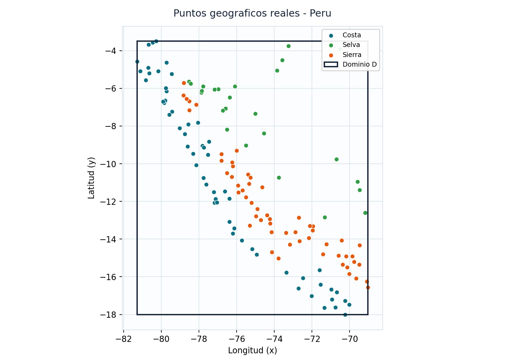
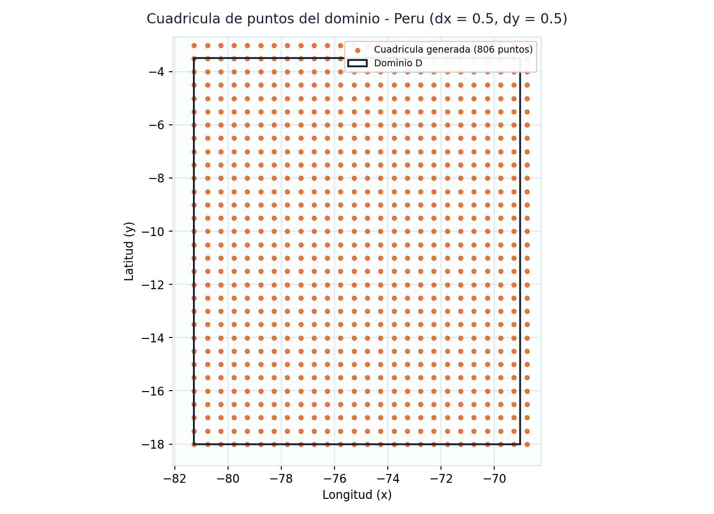
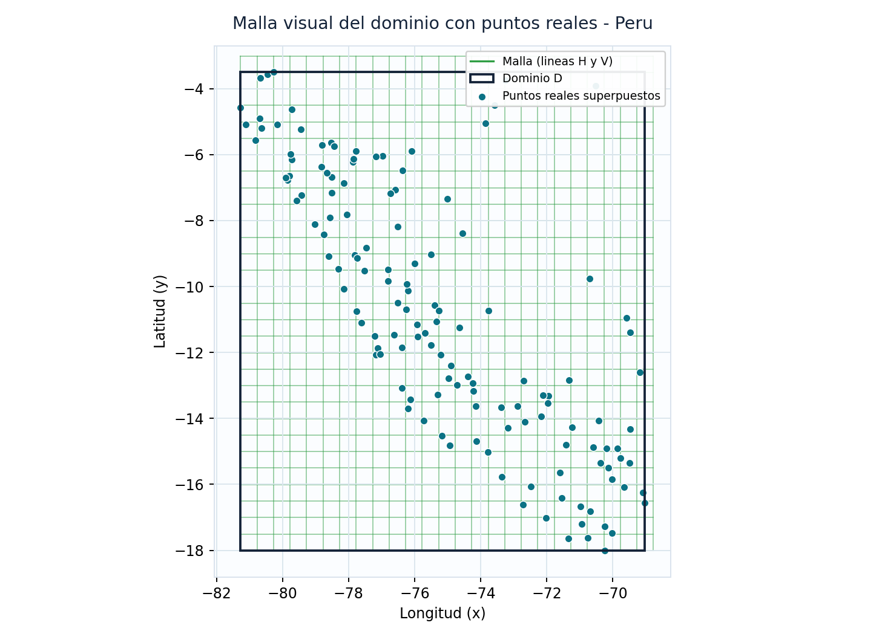
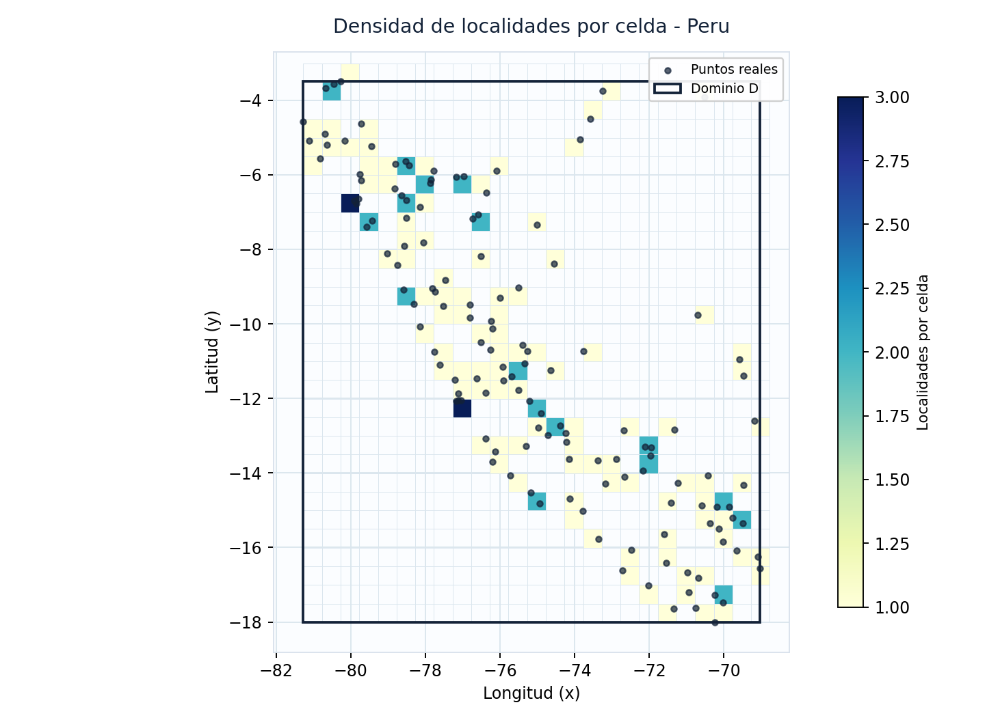
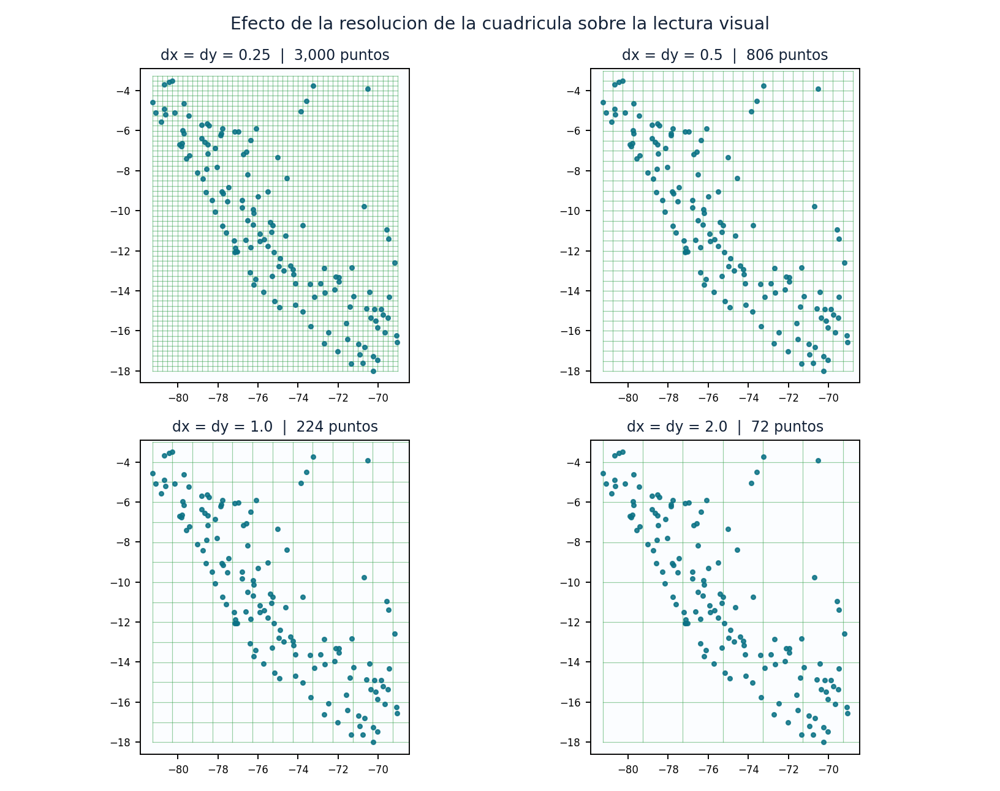
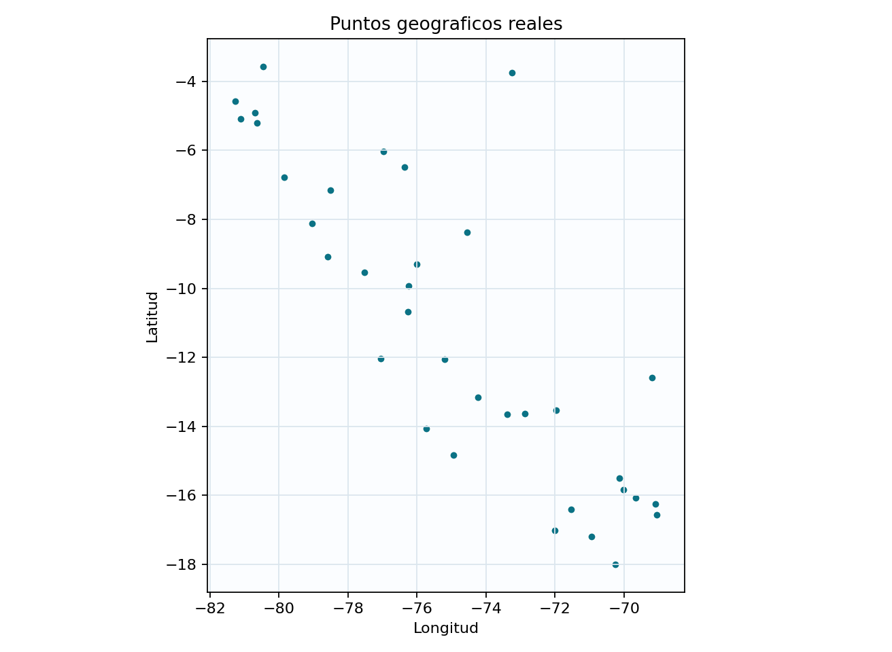
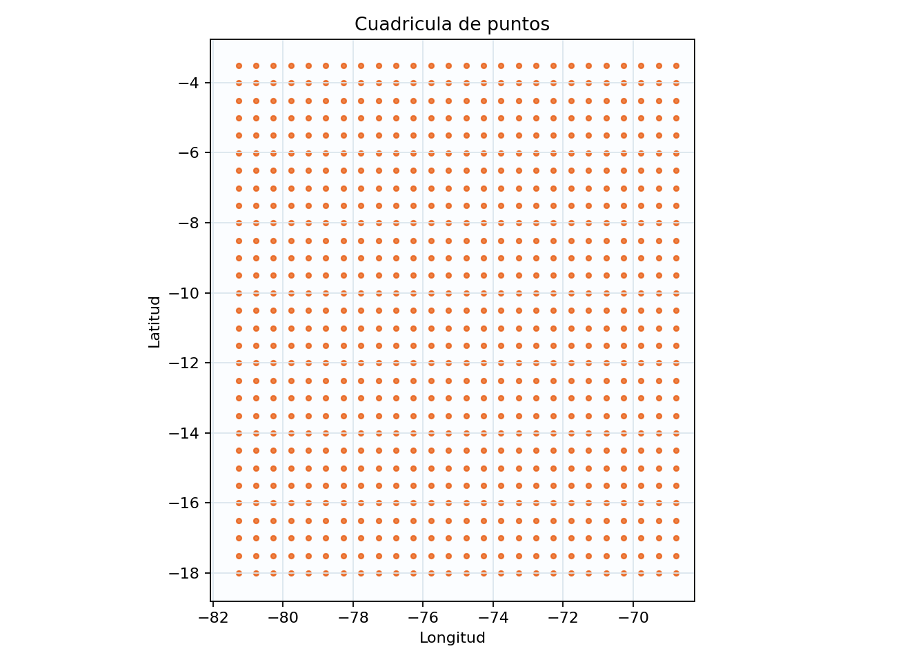
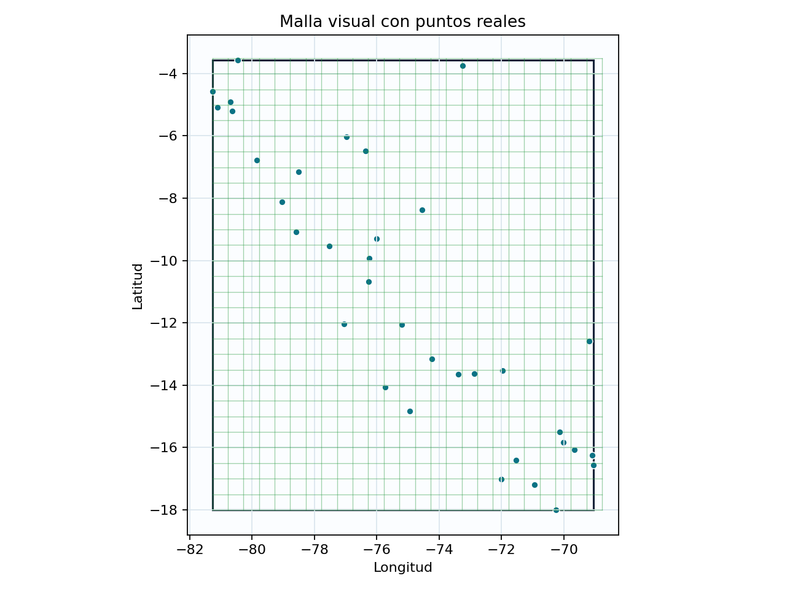

# Práctica Calificada N.º 02 — Unidad 2

## Visualización de dominios geográficos mediante puntos, cuadrículas y mallas


| | |
|---|---|
| **Estudiante** | Jhon Marco Aracayo Mamani |
| **Curso** | Visualización de Datos |
| **Programa** | Ingeniería de Sistemas — Universidad Nacional del Altiplano, Puno |
| **Unidad temática** | Unidad 2 — Técnicas de modelado de dominios |
| **Dataset** | [Geolocation Data \[Longitude Latitude\] — Kaggle](https://www.kaggle.com/datasets/liewyousheng/geolocation) |
| **País analizado** | Perú (139 localidades: capitales departamentales, provinciales y distritos) |
| **Informe final** | **[informe/INFORME_PRACTICA_02.pdf](informe/INFORME_PRACTICA_02.pdf)** — 17 páginas |

---

## 1. Qué hace este proyecto

Resuelve **las siete actividades** de la práctica con datos geográficos reales del Perú:
delimita un dominio rectangular a partir de coordenadas, dibuja los puntos reales, genera
una cuadrícula regular con `np.meshgrid`, construye la malla visual y **cuantifica** la
interpretación (densidad por celda, cobertura de la malla, sensibilidad a dx/dy).

Se puede revisar de tres formas, todas partiendo del mismo código:

| Forma de uso | Comando | Para qué sirve |
|---|---|---|
| **Script reproducible** | `python main.py` | Imprime las 7 actividades en consola, guarda las 5 figuras y **genera el informe PDF**. Un solo comando reproduce todo el trabajo. |
| **App interactiva** | `python -m streamlit run app.py` | Explorar, filtrar por región/zona/ciudad, mover dx y dy, ver los mapas reales y descargar el PDF. |
| **Tests automáticos** | `python -m pytest` | 37 pruebas que verifican dominio, limpieza, cuadrícula, métricas e informe. |

---

## 2. Instalación y ejecución (paso a paso)

```bash
# 1. Clonar el repositorio
git clone https://github.com/tamoil-0/VA_PRACTICA2.git
cd VA_PRACTICA2

# 2. Instalar dependencias (Python 3.10 o superior)
pip install -r requirements.txt

# 3a. Generar TODO el trabajo: consola + figuras + informe PDF
python main.py

# 3b. O abrir la aplicación interactiva
python -m streamlit run app.py
```

En Windows también basta con hacer **doble clic** en:

- `run_app.bat` → abre la aplicación en el navegador (busca un puerto libre automáticamente).
- `run_informe.bat` → genera el informe PDF y las figuras, sin abrir nada más.

### Qué produce `python main.py`

```text
informe/INFORME_PRACTICA_02.pdf       <- producto final (17 páginas, con carátula)
docs/figuras/01_puntos_reales.png     <- Actividad 4
docs/figuras/02_cuadricula.png        <- Actividad 5
docs/figuras/03_malla_visual.png      <- Actividad 6
docs/figuras/04_densidad_por_celda.png
docs/figuras/05_efecto_dx_dy.png
salidas/tabla_limpia.csv              <- Actividad 2
salidas/dominio_limites.csv           <- Actividad 3
salidas/cuadricula_puntos.csv         <- Actividad 5
salidas/densidad_por_celda.csv
salidas/localidades.geojson
```

Opciones disponibles:

```bash
python main.py --pais Peru --dx 0.5 --dy 0.5      # valores por defecto
python main.py --region Puno --dx 0.25 --dy 0.25  # solo Puno, malla más fina
python main.py --csv data/kaggle/cities.csv       # usar el CSV completo de Kaggle
python scripts/descargar_dataset_kaggle.py        # descargar el dataset original
```

---

## 3. Resultados obtenidos

Ejecución por defecto (Perú completo, dx = dy = 0.5):

| Indicador | Valor |
|---|---|
| Registros del archivo | 139 |
| Localidades limpias (Actividad 2) | 139 |
| Dominio (Actividad 3) | **D = [-81.2719, -69.0417] × [-18.0066, -3.5011]** |
| Amplitud del dominio | 12.23° × 14.51° ≈ 2 145 347 km² |
| Cuadrícula (Actividad 5) | 26 × 31 = **806 puntos** generados |
| Malla (Actividad 6) | 31 líneas horizontales + 26 verticales = **750 celdas** |
| Cobertura de la malla | 118 de 750 celdas ocupadas (**15.7 %**) |
| Distancia media al vecino más cercano | 47.9 km |

### Actividad 4 — Puntos geográficos reales



Longitud en el eje X, latitud en el eje Y, título descriptivo, etiquetas de ejes, cuadrícula
de fondo y color por región natural. Los puntos dibujan el eje costero y los corredores
andinos: la distribución es **agrupada, no uniforme**.

### Actividad 5 — Cuadrícula de puntos



806 nodos generados cada 0.5° dentro del dominio. La cuadrícula llega hasta `xmax + dx`
porque `np.arange` excluye el extremo final; así el borde del dominio queda cubierto y la
separación se mantiene constante.

### Actividad 6 — Malla visual



Líneas horizontales y verticales, rectángulo del dominio y los 139 puntos reales
superpuestos sobre la estructura.

### Análisis complementario (más allá de lo exigido)

| Densidad por celda | Efecto de dx y dy |
|---|---|
|  |  |

La malla no se queda en recurso decorativo: se usa como instrumento de medida
(`np.histogram2d`) para contar localidades por celda y para demostrar con números qué ocurre
al cambiar la resolución.

| dx = dy | Puntos generados | Celdas | Celdas ocupadas | Cobertura | Máx. por celda |
|---|---|---|---|---|---|
| 0.25 | 3 000 | 2 891 | 133 | 4.6 % | 3 |
| **0.5** | **806** | **750** | **118** | **15.7 %** | **3** |
| 1.0 | 224 | 195 | 72 | 36.9 % | 5 |
| 2.0 | 72 | 56 | 30 | 53.6 % | 13 |

Al reducir el paso, el detalle crece de forma cuadrática y la mayoría de celdas queda vacía;
al aumentarlo se gana legibilidad y se pierde precisión espacial (una sola celda llega a
agrupar 13 localidades distantes entre sí).

---

## 4. Cómo se cumple cada punto de la rúbrica

| Criterio (rúbrica) | Pts | Dónde verificarlo |
|---|---|---|
| Exploración del dataset | 3 | [vizdominios/dataio.py](vizdominios/dataio.py) (`dataset_overview`, `column_profile`) · pestaña **1. Exploración** · informe §2 |
| Limpieza y filtrado de datos | 3 | [vizdominios/dataio.py](vizdominios/dataio.py) (`clean_data`, auditoría de 5 pasos) · pestaña **2. Limpieza** · informe §3 |
| Delimitación del dominio | 4 | [vizdominios/domain.py](vizdominios/domain.py) (`GeoDomain`) · pestaña **3. Dominio** · informe §4 |
| Visualización de puntos reales | 3 | `figures.fig_points` / `charts.chart_points` · informe §5 y figura 1 |
| Generación de cuadrícula | 3 | `domain.Grid.from_domain` (`np.meshgrid`) · informe §6 y figura 2 |
| Construcción de malla | 2 | `figures.fig_mesh` / `charts.chart_mesh` · informe §7 y figura 3 |
| Interpretación visual | 2 | [vizdominios/content.py](vizdominios/content.py) (respuestas con cifras reales) · informe §9 y §10 |
| **Total** | **20** | Tabla de verificación dentro del informe (§12) y en la pestaña **Resumen** |

### Producto final a entregar (sección 9 de la práctica)

Los 14 elementos exigidos están en el PDF y en ese orden: carátula, título de la práctica,
descripción del dataset, enlace del dataset, tabla de columnas principales, país
seleccionado, tabla limpia, tabla de límites del dominio, gráfico de puntos reales, gráfico
de cuadrícula, gráfico de malla visual, interpretación de resultados, conclusiones y anexo
con el código Python.

### Preguntas de análisis (sección 10 de la práctica)

Las siete respuestas están en el informe §10, en la pestaña **7. Interpretación** de la app
y reunidas en [docs/RESPUESTAS.md](docs/RESPUESTAS.md). No son texto genérico: cada una cita
las cifras del análisis realmente ejecutado.

---

## 5. Estructura del proyecto

```text
practica2/
├── app.py                      # Punto de entrada Streamlit (solo conecta piezas)
├── main.py                     # Ejecución reproducible por consola + informe PDF
├── requirements.txt
├── pytest.ini
├── run_app.bat / run_app.ps1   # Lanzadores para Windows
├── run_informe.bat             # Genera el PDF con doble clic
│
├── vizdominios/                # Paquete con toda la lógica
│   ├── config.py               # Rutas, metadatos, paleta, constantes
│   ├── domain.py               # ColumnMap · GeoDomain · Grid       (Act. 1, 3, 5)
│   ├── dataio.py               # Carga, exploración, limpieza, filtros (Act. 1, 2)
│   ├── analysis.py             # Densidad, haversine, sensibilidad a dx/dy (Act. 7)
│   ├── figures.py              # Figuras Matplotlib para el PDF     (Act. 4, 5, 6)
│   ├── charts.py               # Gráficos Plotly interactivos
│   ├── maps.py                 # Mapas sobre OpenStreetMap (valor agregado)
│   ├── content.py              # Interpretaciones y respuestas con cifras reales
│   ├── pipeline.py             # Orquestador: ejecuta las 7 actividades
│   ├── report.py               # Informe PDF (ReportLab)
│   └── ui/                     # theme.py · sidebar.py · tabs.py
│
├── data/peru_localidades.csv   # Dataset de trabajo (139 localidades del Perú)
├── scripts/descargar_dataset_kaggle.py
├── tests/                      # 37 pruebas con pytest
├── docs/
│   ├── RESPUESTAS.md           # Respuestas a todas las preguntas de la práctica
│   ├── figuras/                # Figuras generadas por main.py
│   ├── capturas/               # Capturas de la aplicación
│   └── practica_calificada_02-Unidad2_visualizacion_datos.pdf
├── informe/INFORME_PRACTICA_02.pdf
└── salidas/                    # Exportaciones (CSV y GeoJSON)
```

### Por qué está organizado así

- **Una sola fuente de verdad.** `pipeline.run_analysis()` ejecuta las siete actividades y
  devuelve un objeto `AnalysisResult`. La app, el script de consola, los tests y el PDF
  consumen ese mismo objeto, así que **los tres caminos dan resultados idénticos**.
- **Los textos no están duplicados.** Interpretaciones, respuestas y conclusiones viven en
  `content.py` y se construyen con las cifras reales del análisis: si cambia el país, el
  filtro o dx, las conclusiones se recalculan solas.
- **`app.py` tiene 70 líneas.** La versión anterior era un solo archivo de 1 011 líneas con
  la lógica, el CSS, los gráficos y el PDF mezclados.

---

## 6. Sobre el dataset

La práctica indica el dataset **Geolocation Data [Longitude Latitude]** de Kaggle, cuyos CSV
pesan cientos de MB y no pueden subirse a GitHub. Por eso el repositorio incluye
`data/peru_localidades.csv`: **139 localidades reales del Perú** (las 25 capitales
departamentales más capitales provinciales y distritos representativos de los 24
departamentos y el Callao), con el mismo esquema de columnas que el dataset original
(`city_name, country_name, region_name, place_type, latitude, longitude`). Las coordenadas
son valores de referencia públicos redondeados a 4 decimales.

Para trabajar con el dataset completo de Kaggle:

```bash
python scripts/descargar_dataset_kaggle.py      # requiere kaggle.json
python main.py --csv data/kaggle/cities.csv --pais Peru
```

La detección de columnas es automática (`latitude`, `lat`, `y`, `gps_latitude`…), así que el
proyecto funciona igual con cualquiera de los CSV del dataset original o con otro CSV
geográfico.

---

## 7. La aplicación interactiva

Diez pestañas, una por bloque de la práctica:

| Pestaña | Contenido |
|---|---|
| **Resumen** | Trazabilidad de las 7 actividades + verificación de la rúbrica |
| **Mapa real** | Puntos, cuadrícula y malla proyectados sobre OpenStreetMap |
| **1. Exploración** | Registros, columnas, perfil de tipos y nulos, primeras filas |
| **2. Limpieza** | Auditoría paso a paso, tabla limpia, descarga CSV/GeoJSON |
| **3. Dominio** | Tabla de límites, notación matemática, área en km² |
| **4-6. Visualizaciones** | Puntos, cuadrícula, malla y comparación real vs. generado |
| **Análisis extra** | Mapa de calor por celda, cobertura, sensibilidad a dx/dy |
| **7. Interpretación** | Las 4 preguntas + las 7 de análisis + conclusiones |
| **Informe PDF** | Genera y descarga el informe con los filtros actuales |
| **Código** | Código mínimo reproducible, descargable como `.py` |

Filtros de la barra lateral: **país**, **región/departamento**, **zona macro**
(Norte/Centro/Sur), **región natural** (Costa/Sierra/Selva), **ciudad** y los deslizadores de
**dx** y **dy**. Cada cambio recalcula el dominio, la cuadrícula, la malla, las métricas y el
informe: si se elige solo Puno, el dominio deja de ser el del Perú y pasa a ser el de Puno.

| Localidades sobre el mapa | Cuadrícula sobre el mapa | Malla sobre el mapa |
|---|---|---|
|  |  |  |

---

## 8. Verificación automática

```bash
python -m pytest -v
```

Las 37 pruebas verifican, entre otras cosas:

- que el dominio use exactamente los mínimos y máximos observados y que **todos** los puntos
  caigan dentro;
- que la cuadrícula tenga separación constante y cubra el dominio completo;
- que la limpieza descarte cada tipo de registro inválido (otro país, coordenada de texto,
  nula, fuera de rango, duplicada) y que la auditoría cuadre;
- que la cuadrícula del proyecto coincida con `np.meshgrid` del código base de la práctica;
- que el haversine reproduzca la distancia Lima–Puno (≈ 850 km);
- que el código del anexo compile y que el PDF se construya con más de 8 páginas.

---

## 9. Conclusión

El modelado de dominios permite pasar de un CSV de coordenadas a un área de análisis
explícita; la cuadrícula convierte ese espacio continuo en unidades discretas y la malla
aporta la estructura que hace posible medir densidad y cobertura. Las tres visualizaciones
son complementarias: los puntos muestran los hechos, la cuadrícula aporta el sistema de
medida y la malla la estructura de agregación. Sobre esa base se construyen aplicaciones de
Ingeniería de Sistemas como cobertura de servicios digitales, redes de sensores IoT,
distribución de usuarios, diseño de rutas y tableros de decisión territorial.

Detalle completo en **[informe/INFORME_PRACTICA_02.pdf](informe/INFORME_PRACTICA_02.pdf)**.
